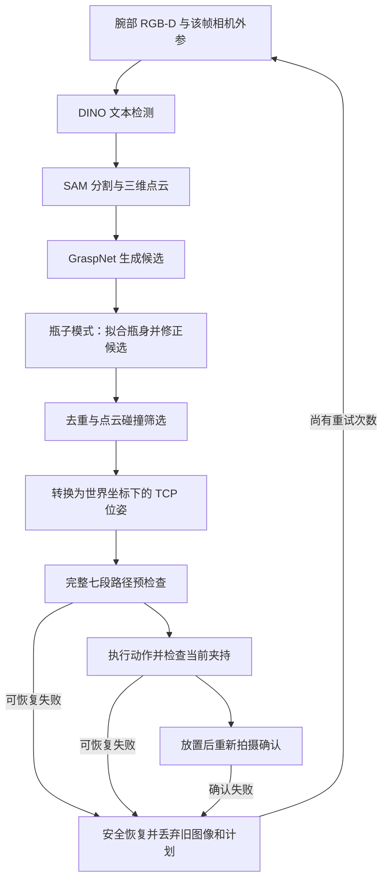

# PiperX 仿真视觉抓取工作总结

记录日期：2026-10-17，已同步 D435i 实机接入方案的最新确认。本文总结本轮接入做了什么、如何实现、验证到什么程度，以及后续使用方式。详细安装步骤见 [PiperX 仿真说明](piperx_sim.md)，验收数字来自 [抓取验收记录](piperx_grasp_validation.json)，实机最小准备项见 [realrobot_need.md](../realrobot_need.md)。本文整理已有代码和运行记录，本次更新没有重新安装依赖或重跑全部实验。

## 1. 最终完成了什么

我们把原仓库中的 Piper 仿真使用流程扩展为一套可运行的 **PiperX 桌面视觉抓放演示**：

- 使用官方 PiperX 本体与 AGX 平行夹爪模型，在 MuJoCo 中执行接近、下降、夹持、抬升、搬运、放置和撤离。
- 在 `piper_mujoco` Conda 环境中配置视觉依赖、CUDA 扩展与本地预训练权重。
- 通过腕部 RGB-D 相机完成文本检测、分割、点云生成和抓取候选预测。
- 默认抓取蓝色小瓶子，保留原红色方块选项。
- 在 MuJoCo 窗口中显示实时 RGB、深度图和最终选中的抓取位姿。
- 加入完整路径预检查、当前夹持反馈、放置后视觉确认，以及失败后的恢复与重新感知。

本轮范围为仿真，没有接入真机、CAN 通信或真实深度相机。仓库原有其他机械臂入口仍保留，本轮重点验证的是新增 PiperX 流程。

后续实机相机已确认为 RealSense D435i，拟采用“上游提供点云、机械臂控制器负责逆解和运动”的路线；该实机适配尚未实现，仿真结果不作为实机验证结果。

## 2. 工作推进过程

| 阶段 | 遇到的问题或需求 | 实际处理方式 |
| --- | --- | --- |
| 原 Piper 模型加载 | 网格路径被重复拼接，找不到 `link2_0.obj` | 移除旧 `piper.xml` 中重复生效的 `meshdir="assets"`，保留网格自身相对路径 |
| 更换为 PiperX | 需要确认新机械臂型号并接入仿真 | 使用 `external/agx_arm_urdf` 中的官方 PiperX 与 AGX 夹爪，编写模型生成器 |
| 基础抓放 | 先确认模型、夹爪和控制能够工作 | 建立不依赖视觉权重的已知坐标抓放入口，再验证实际接触夹持 |
| 视觉环境 | 缺少 PyTorch、视觉模型及本地扩展 | 在指定 Conda 环境中安装兼容版本，编译 CUDA 扩展，下载并验证权重 |
| 视觉抓放 | 图像坐标、抓取轴和机器人 TCP 约定不同 | 核对 RGB/BGR、米制深度、相机外参和坐标轴转换，接入候选筛选与运动控制 |
| 可靠执行 | 单个目标逆解成功仍可能在途中失败 | 改为运动前检查完整七段路径，并验证当前双指夹持状态 |
| 相机安装 | 用户要求相机装在夹爪支架上并摆正 | 从固定俯视相机改为腕部相机，最终贴装在夹爪横梁前侧中央，取消倾角 |
| 更换物体 | 用户选择瓶子 | 增加刚性瓶子模型，并用分割点云拟合瓶身，修正容易擦过瓶肩的候选 |
| 可视化 | 需要看到相机图像和抓取位姿 | 增加 RGB/深度窗口内嵌图、三维坐标轴、夹爪轮廓、数值与诊断图片 |
| 实机准备 | 明确 D435i 与 PiperX 的最小交付资料 | 核对点云和笛卡尔控制接口，将独立内参文件与运动学模型文件改为按接入方式选择的资料 |

前序 AI 已产出的代码也纳入实际阅读、整合和复测；完成情况以运行报告和测试结果为依据。

## 3. PiperX 模型和物理控制如何接入

### 3.1 从官方模型生成 MJCF

模型来源是本地 `external/agx_arm_urdf`，接入时记录的提交为 `680fa925cd00db7e2628563d2edc5540963045de`。

`scripts/build_piperx_model.py` 读取本体 URDF 和带夹爪的 Xacro，生成：

- `manipulator_grasp/assets/agilex_piper_x/piperx.xml`：MuJoCo 机械臂模型。
- `manipulator_grasp/assets/agilex_piper_x/piperx.urdf`：展开后的机器人描述。

生成器保留官方连杆位置、关节轴、限位、质量和惯量，并使用上游 STL 网格。它针对当前上游文件结构实现，不需要额外运行 ROS 或 xacro。模型仍依赖外部仓库的网格，不能只拷贝生成的 XML 就删除 `external/agx_arm_urdf`。

### 3.2 夹爪与 TCP

机械臂有六个转动关节。夹爪保留两个真实滑动指关节，通过 equality joint 约束满足 `q_right = -q_left`，使用 tendon 表示总开口，指令范围为 0–0.10 m。

TCP 位于夹爪基座局部 `(0, 0, 0.125)` m：Y 轴为开合方向，+Z 轴为接近方向。夹指内侧添加了薄接触垫，用接触和摩擦夹持物体。

### 3.3 运动控制

环境 `PiperXGraspEnv` 使用 MuJoCo TCP 雅可比和阻尼最小二乘求逆解，使用位置执行器及重力/Coriolis 前馈驱动机械臂。运动采用平滑位置插值和最短弧姿态插值。

物体是带自由关节的刚体。抓取过程中通过执行器运动和接触作用移动物体；直接设置物体初始位置只用于演示开始前的场景布置。

两个入口用途不同：

| 入口 | 抓取目标位置来源 | 用途 |
| --- | --- | --- |
| `main_piperx.py` | 仿真物体已知中心 | 隔离检查机器人模型、控制和接触抓放 |
| `main_piperx_vision.py` | RGB-D 检测、点云及抓取候选 | 当前完整视觉抓放流程 |

## 4. 视觉依赖和权重如何准备

所有 Python 包及 CUDA 编译依赖安装在 `piper_mujoco` Conda 环境中。已有验收记录中的核心组合如下：

| 项目 | 已验证配置 |
| --- | --- |
| Python / MuJoCo | Python 3.10.22 / MuJoCo 3.16.0 |
| NumPy | 1.23.4 |
| PyTorch / torchvision | 2.0.1+cu118 / 0.15.2+cu118 |
| CUDA 扩展编译工具链 | Conda 内 CUDA 11.8 |
| GPU | NVIDIA RTX 4060 Ti |
| 主要本地扩展 | GroundingDINO `_C`、PointNet++、KNN、GraspNet API/NMS |

系统原有 `nvcc` 为 11.5；为匹配 PyTorch，额外在 Conda 环境中准备了 CUDA 11.8 编译工具链，没有修改系统 NVIDIA 驱动。环境验收包括模块导入、GPU 算子运行、模型前向和依赖一致性检查。

视觉入口使用以下本地权重：

| 模型 | 用途 | 路径 |
| --- | --- | --- |
| GroundingDINO SwinT | 按文本检测目标 | `weights/groundingdino_swint_ogc.pth` |
| BERT | DINO 文本编码 | `weights/bert-base-uncased/` |
| SAM-B | 根据检测框分割目标 | `weights/sam_b.pt` |
| GraspNet | 点云抓取候选预测 | `weights/logs/log_rs/checkpoint-rs.tar` |

另为原有视觉分支准备了 YOLO-World 与 CLIP 权重；PiperX 当前主流程使用 DINO、SAM 和 GraspNet。旧 `cv_process.py` 也改为从配置的权重目录加载 YOLO 和本地 CLIP。

模型加载配置使用本地文件，避免运行时再次下载文本编码器。权重及生成的视觉诊断目录已加入 Git 忽略规则。依赖和权重的已有验收分别见 [视觉环境报告](piperx_vision_validation.json)、[权重报告](piperx_weights_validation.json)。

## 5. 抓取位姿怎样生成



方块模式跳过图中的瓶身修正。默认最多执行三轮新感知尝试；达到次数上限或恢复失败会停止。

### 5.1 图像和点云

视觉入口采集 1280×960 的 RGB 和米制深度，默认检测提示词为 `blue bottle .`。切换到方块时自动使用 `red cube .`。

当前仿真入口中，GroundingDINO 定位目标，SAM 生成分割掩码；程序结合深度和相机内参生成点云，并依据桌面范围和高度过滤。GraspNet 从检测目标附近的工作区域采样约 20,000 个点，输出候选位置、旋转、开口、深度和模型评分。

D435i 实机若由 SDK 或上游直接提供公制 XYZ 点云，抓取模块可直接接收点云，不再要求用户另交内参文件。保留 DINO/SAM 时，还需 RGB 与点云的像素对应关系；直接提供目标点云时，可以跳过检测与分割。RGB 位姿叠加等投影功能仍需相机参数或等价投影接口，可由 SDK 提供。

接入时专门核对了两项约定：MuJoCo 输出 RGB，DINO 的 `Model` 接口接收 BGR；MuJoCo Renderer 的深度以米表示，应按米制深度进行反投影。

### 5.2 腕部相机坐标转换

每次采集图像时保存相机内参和 `T_world_camera`。从候选到机器人 TCP 的变换为：

```text
T_world_tcp = T_world_camera × T_camera_grasp × T_grasp_tcp
```

其中 `T_grasp_tcp` 处理 GraspNet 接近轴 +X 与机器人 TCP 接近轴 +Z 的差异。相机光学坐标采用 X 向右、Y 向下、Z 向前，也处理了它与 MuJoCo 相机轴向的区别。

感知和候选转换使用曝光时保存的外参。腕部之后移动，不会改变旧帧点云和候选的坐标解释。当前仿真相机外参由 MuJoCo 模型状态提供；真实相机标定不在本次工作范围内。

### 5.3 为什么瓶子增加了几何修正

直接使用候选时，部分姿态偏向瓶肩或瓶颈，夹爪下降后容易擦过瓶身。移动位置实验曾连续出现空夹，当前触觉检查将这些尝试判为失败。

修正方式全部基于分割后的点云：

1. 选择瓶身下段可见点，拟合其在 XY 平面上的圆，估计中心与半径。
2. 用低位可见点估计夹持高度：Z 的 0.2% 分位值加 20 mm。
3. 保留 GraspNet 候选的模型评分及投影到水平面的开合方向，将接近方向设为竖直向下。
4. 将检查开口设为估计直径加 12 mm，上限为 95 mm；碰撞代理采用 AGX TCP 接触平面，插入深度设为零。
5. 对修正后的候选做去重、点云碰撞筛选和完整路径检查。

因此当前瓶子模式结合了预训练候选与针对直立小瓶子的几何规则。评分沿用原模型候选，没有针对修正后的位姿重新运行评分网络。圆柱面拟合失败会结束该轮尝试，不读取瓶子真实位姿补充抓取目标。

### 5.4 当前仿真中的完整路径检查

能够求出单个抓取目标的逆解，不代表搬运途中也能到达。程序在执行前，依次检查接近、下降、抬升、搬运、下放、撤离及返回观察位七段轨迹，检查逆解残差、关节限位、关节跳变和采样位置上的自身/桌面碰撞。

候选按评分顺序检查，选择第一个完整路径可执行的候选。执行缓存计划前还检查起始关节状态是否已过期。

这套检查使用本地机器人模型。后续若改由实机控制器直接执行笛卡尔目标，需要替换相应接口，不能同时默认保留这套仿真的整臂路径预检查。

### 5.5 夹住与放好的判断

夹持确认使用持续的当前双指接触、夹爪开口和 TCP 抬升量。历史上接触过物体，不会被当作当前仍夹持成功。

放置后返回观察位，重新采集 RGB-D 并识别目标，确认其落在放置区域附近。失败时尝试安全恢复，再拍新图、生成新候选和新计划。物体真实抬升高度、最终位置及碰撞记录在策略结束后独立验收，视觉控制策略不读取这些真值。

## 6. 相机、瓶子和显示怎样实现

### 6.1 相机的最终安装状态

根据用户反馈，相机从腕部侧上方调整到两根夹指上方的黑色横梁前侧中央，并去掉了先前为了覆盖桌面而设置的倾斜。

| 项目 | 当前配置 |
| --- | --- |
| 相机名称 / 所属子体 | `wrist` / `wrist_camera_mount` |
| 连接位置 | `gripper_base` 下的夹爪横梁前侧中央 |
| 壳体中心相对基座 | `(-0.055, 0, 0.048)` m |
| 安装倾角 | 0°，外壳与横梁平行 |
| 镜头方向 | 夹爪基座 +Z，朝向夹指前方 |
| 垂直视场角 | 120°，覆盖当前抓取和放置区域 |
| 感知 / 预览分辨率 | 1280×960 / 320×240 |

机壳、双镜头和短安装板保存在模型生成器中，重新生成模型会保留。相机外观目前为零质量、无碰撞的显示几何，实际载荷尚未建模。固定 `top` 相机已经移除，`overview` 用于观察场景，抓取读取腕部 `wrist`。

### 6.2 瓶子模型

`bottle.xml` 使用瓶身圆柱、瓶肩椭球、瓶颈圆柱和瓶盖组成一个自由刚体。蓝色瓶身、白色标签、橙色瓶盖用于外观区分；标签不参与碰撞。

瓶子高 73 mm，瓶身直径 34 mm，总质量 40 g。它是简化刚性模型，没有液体或柔性瓶壁。切换为 `--object cube` 时，在模型编译前替换为原 36 mm 红方块，并重新计算惯量。

### 6.3 实时相机画面

窗口右上角嵌入腕部 RGB 和深度伪彩色图，直接使用 MuJoCo viewer 图像叠加接口。预览复用 Renderer，按仿真时间最多 10 帧/秒更新，适应窗口尺寸。深度色标固定为 0.05–1.00 m，无效值显示黑色。

运动及 `--hold` 阶段持续更新；模型推理、规划或抓取前停留期间，仿真暂停，预览保留当前帧。退出时先释放预览渲染资源，再关闭主窗口。视觉分辨率在创建窗口前设置，避免默认小缓冲区导致渲染失败；窗口关闭时等待相关线程退出，解决了清理阶段的问题。

### 6.4 抓取位姿显示

显示的是通过路径检查后的最终拾取 TCP：红、绿、蓝分别表示 X、Y、Z 轴，青色表示夹爪轮廓，黄色表示接近方向。左下角显示世界坐标 XYZ、RPY 和开口；诊断文件还保存 `wxyz` 四元数。

示意图中的开口用于候选显示和碰撞检查。实际动作会先张开夹爪，再闭合并根据当前接触确认夹持。

三维标记只写入显示场景，不改变物理模型。腕部 RGB 中的标记用当前相机外参重新投影，在源图副本上绘制，不进入视觉推理。

默认抓取前停留 2 秒，可调整为 10 秒观察。物体搬走后，标记仍表示原拾取位姿；重试会清除旧标记并显示新选择。


上图为本机生成的诊断图，所在 `vision_runs/` 目录未加入 Git，换机器后需要重新运行生成。

## 7. 已验证的结果与边界

桌面现已增加紫色方块、绿色长方体、黄色圆柱，与原蓝瓶共四个独立自由刚体；新增模型见 `manipulator_grasp/assets/agilex_piper_x/table_objects.xml`，位置和尺寸见 [仿真说明](piperx_sim.md)。原放置区留空，切换原目标为红方块时仍保留其他三个物体。当前仍执行一次目标抓放，多个物体逐个抓取尚未实现。新增绿色瓶子的试验出现颜色误识别，因此最终使用不同形状的绿色长方体；不能据此认为已经解决相似目标区分问题。

最终四物体场景已复测：29 项测试全部通过，四个物体稳定直立且在初始腕部画面可见；蓝瓶视觉抓放一次成功，抬升 98.57 mm、放置误差 0.80 mm。结果保存在本地 `docs/vision_runs/multi_objects_grasp_final/result.json`，相机图与稳定性检查在 `docs/vision_runs/multi_objects_scene/`；新增各形状的视觉抓放尚未验证。

以下数据来自已有 [抓取验收记录](piperx_grasp_validation.json)，是具体场景的运行结果，不是多次随机实验统计成功率。

| 场景 | 物理抬升 | 放置 XY 误差 | 恢复次数 | 结果 |
| --- | --- | --- | --- | --- |
| 默认瓶子 | 98.57 mm | 0.76 mm | 0 | 成功 |
| 瓶子移动到 `(0.30, 0.08)` | 98.58 mm | 0.64 mm | 0 | 成功 |
| 瓶子实际窗口与实时相机图 | 98.57 mm | 0.76 mm | 0 | 成功 |
| 原红方块回归 | 99.98 mm | 4.34 mm | 0 | 成功 |

以上四组均没有记录到机械臂自身/桌面接触或 MuJoCo 警告。相机预览窗口实验记录了 178 帧更新。

抓取位姿显示另完成了无窗口诊断和实际窗口验证，均成功抓放，导出位姿与实际选中位姿一致。窗口实验使用 5 秒抓取前停留。原方块在早期相机配置下的旋转、松爪恢复等实验保留在本地历史诊断中，没有混作本次瓶子验证结果。

已有 **29 项测试全部通过**，包括原方块物理抓放、瓶子接触抓放、逆解和完整路径、过期计划拒绝、当前触觉、恢复后新感知、腕部相机随动与旧帧外参、瓶身拟合，以及显示标记和预览资源管理。

当前适用范围与未完成事项：

- 已验证现有桌面上的单个直立小瓶子和红方块；任意物体、任意尺寸、倾倒瓶子和杂乱堆叠需要继续适配。
- 瓶身拟合使用圆柱假设和当前场景尺度的高度带，需要看到下段瓶壁。
- 逆解为局部求解，避碰为采样检查，没有通用全局避障规划。
- 图像在感知、放置确认和恢复后更新；实时预览提供观察，不构成连续视觉伺服。
- D435i 实时数据、真实外参加载、工具载荷和真机执行尚未接入；已有且对应当前安装的手眼结果可作为实机输入，不要求重新标定。

## 8. 如何运行和复查

从项目根目录进入已配置的环境：

```bash
conda activate piper_mujoco
cd /media/yzc/F/DOGcode/others/Piper_Mujoco_Sim
```

默认瓶子视觉抓放，并在抓取前停留 10 秒查看位姿：

```bash
python main_piperx_vision.py --hold --grasp-preview-seconds 10
```

常用变体：

```bash
# 切回原红方块；检测提示词自动切换
python main_piperx_vision.py --object cube --hold

# 无窗口运行，保留诊断输出
python main_piperx_vision.py --headless --fast

# 更改初始位置
python main_piperx_vision.py --obj-x 0.30 --obj-y 0.08 --hold

# 关闭实时相机显示，但继续使用视觉感知
python main_piperx_vision.py --no-camera-preview --hold

# 仅验证已知坐标下的控制和接触抓放
python main_piperx.py --hold

# 运行全部 PiperX 测试
python -m unittest discover -s tests -p 'test_piperx_*.py' -v
```

`--text` 可手动覆盖检测提示词；当前默认瓶子应使用 `blue bottle .`，不要沿用旧方块命令中的 `red cube .`。`--grasp-preview-seconds 0` 可取消抓取前停留。

默认诊断目录为 `docs/vision_runs/<时间戳>/`，也可通过 `--diagnostics-dir` 指定。每轮主要文件如下：

| 文件 | 内容 |
| --- | --- |
| `cycle_00/pickup/rgb.png`、`depth.npy`、`camera.json` | 感知帧、米制深度、该帧内外参 |
| `bboxes.png`、`mask.png`、`pointcloud_stats.json` | 检测、分割和点云统计，位于对应感知子目录 |
| `pickup/grasps_raw.npy`、`pickup/bottle_body_fit.json` | 瓶子模式的原始候选和瓶身拟合结果 |
| `cycle_00/grasps.json`、`selected.json` | 候选检查与本轮选择 |
| `cycle_00/grasp_pose.json` | 世界坐标位姿、RPY、四元数、开口 |
| `selected_pose_rgb.png`、`selected_pose_3d.png`、`selected_pose_closeup.png` | 本轮投影、三维全景和近景，位于对应轮次目录 |
| `cycle_00/placement/` | 放置后的新视觉观测 |
| 根目录 `result.json`、`run.log`、`camera_preview.png` | 总验收、日志和有窗口时的预览图 |

## 9. 关键代码索引

| 文件或目录 | 职责 |
| --- | --- |
| `scripts/build_piperx_model.py` | 官方模型转换、夹爪约束、TCP 和相机安装定义 |
| `manipulator_grasp/assets/agilex_piper_x/` | PiperX 模型、桌面场景与瓶子 |
| `manipulator_grasp/env/piperx_grasp_env.py` | 仿真步进、逆解、路径计划、接触与相机接口 |
| `main_piperx.py` | 已知坐标基础抓放 |
| `main_piperx_vision.py` | 感知、候选筛选、显示与独立验收的主入口 |
| `utils/piperx_vision_control.py` | 视觉/触觉抓放、放置确认和恢复流程 |
| `utils/piperx_bottle_grasp.py` | 瓶身点云拟合与候选修正 |
| `utils/piperx_camera_preview.py` | 窗口内实时 RGB/深度图 |
| `utils/piperx_grasp_geometry.py`、`piperx_grasp_display.py` | 位姿示意几何、三维显示、投影和诊断图 |
| `scripts/check_piperx_vision.py`、`check_piperx_weights.py` | 依赖和权重验收 |
| `tests/test_piperx_*.py` | 仿真、控制、相机、物体与显示回归测试 |

开发过程中使用了外部 DeepSeek Flash、max 思考配置辅助限定范围的细节任务，随后在主会话中检查实际修改并执行必要验证。该代理属于开发协作工具，运行本地视觉抓取程序不依赖该代理 API。

## 10. D435i 实机接入的最新结论

### 最小需要提供的资料

| 输入 | 内容 |
| --- | --- |
| 点云 | 公制场景 XYZ、坐标系、采集时间；保留周围场景用于夹爪碰撞筛选 |
| 目标选择 | RGB 与点云对应关系，或直接提供目标点云 |
| 外参标定 | 腕部相机的 `T_flange_camera`；若点云已在基坐标系，则不重复变换 |
| 机械臂/夹爪接口 | 实际末端位姿、笛卡尔运动、完成/故障反馈、停止及夹爪控制与反馈 |
| TCP 约定 | 接口使用法兰还是夹持 TCP；必要时提供 `T_flange_tcp` |

**相机内参文件不是必交项：** 提供点云时，相机 SDK 已完成三维重建所需处理；本项目自行反投影或在 RGB 上投影位姿时，才需要读取相应内参，也可运行时获取。

**独立运动学模型文件不是这条路线的必交项：** 若控制器能返回实际末端位姿、接受笛卡尔目标并完成逆解和运动，项目侧可不维护 URDF/DH。本地逆解、整臂碰撞检查或数字孪生预演仍需要匹配实物的模型。控制器求逆解与整臂环境避障是不同能力。

腕部相机使用曝光时的实际末端反馈与手眼外参计算相机位姿；控制器若接收法兰目标，再把抓取 TCP 目标转换为法兰目标。点云坐标系必须与外参匹配，已有基坐标点云不能重复乘手眼矩阵。

下一步的代码工作是接收真实点云、加载对应外参、接入控制器运动与反馈，并将仿真双指接触判定改为真实可用的夹爪/视觉验证。具体接口边界与变换式见 [实机最小准备清单](../realrobot_need.md)。
